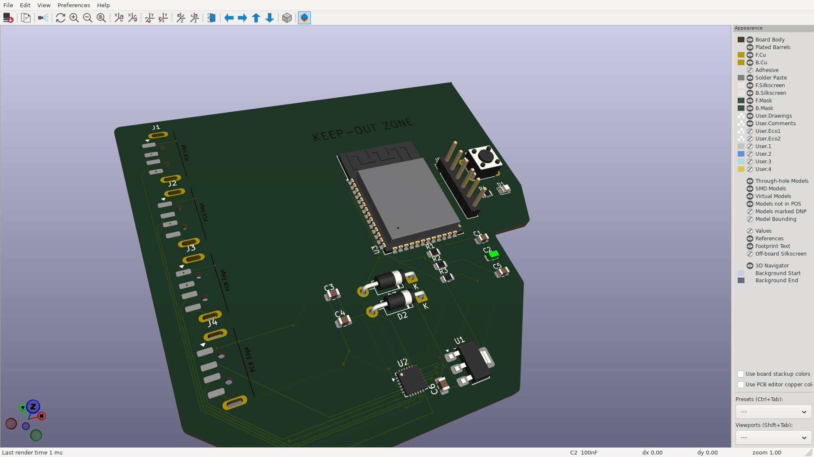
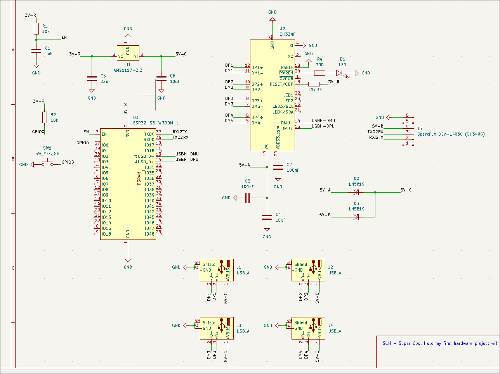

# A Super Cool Hub

This project implements a budget and cool USB Hub thanks to the OTG USB feature that ESP32 S2/S3 brings on! On [BOM.md](https://github.com/hyduez/sch/blob/master/BOM.md) u can find each component with its own link to Aliexpress/Mouser. Due to expensive carriers fees and the niche market of Ecuador, it could be more than 20$ USD. The only firmware u are gonna need, is based on the brain of this PCB; if u want to do something when a state is detected, change the switch to flash the ESP32 and start coding. Anyways, this project aimed to be more; include OLED displays with tact buttons and commands to toggle data traveling, power on ports and show stats on the displays.

Here is the schematic:

You can see a lot of stuff that maybe u dont know where to start. But, as always, start where the power arises. Focus on the CH334F, it's the Mini Hub with 4 ports and another one for the host to manage, in this case, ESP32 S3 WROOM. It provides almost all the energy on the PCB, we are interesed on the 5V-A net label; it's gonna be merged with another line, 5V-B from SparkFun DEV-14050 (based on CH340G), this last one serve as auxiliar line, if u need more power available. Merged, they produce 5V-C, who is in charge of the USBs VBUS and ESP32 S3 WROOM power.

> [!IMPORTANT]
> Notice that this schematic is working with an ESP32 S3 WROOM, that's the reason why there's an AMS1117-3.3 that decrease the voltage from 5V to 3.3V; that's not neccesary with ESP32 S3 Devkit, since it brings its own regulator.

> [!TIP]
> Machine-readable fabrication outputs (Gerbers, drill, BOM CSV, pick and place,
> DRC/ERC) live in [`fabrication/`](fabrication), along with a
> [parts cross-check](fabrication/parts-check.md) against the BOM below. Before
> ordering, note that the PCB uses the bare CH334F QFN-24 and the bare
> ESP32-S3-WROOM-1 module, not the Adafruit breakout / devkit listed in
> [`BOM.md`](BOM.md).

The idea is that u'd add another coproccesor and create an useful artcraft hardware made by your hands, something to be proud. It's cool. You're not flexing something u bought on a minimarket, it's something u built and that's what matters.

## Index

- Inspiration & References
- Data Sheets & Components
- PCB Design
- Fabrication Files

## Inspiration & References
This is my first Hardware project strictly speaking. Instead of following guides, tutorials, projects pre-made; I decided to try it on my own. And here is how I got it: first, u need theory. It migh sounds cliche, but it's neccesary; u cannot start a journey without knowning how to start. Second, u must put into practice, and expand upon, what you DON'T KNOW; u might understand the fundamentals, but u cannot stop there, u've to be willing to try new and unfamiliar things. It seems too hard to make it? That doesn't matter, u're way ahead of it and u MUST be.

I started the last week without knowning even what a SMD, THT or SMT was, but that wasn't excuse to try in 2 days something REALLY cool, while managing a presencial event. I've already a sort of ideas that I wanted to do these 10 weeks, but I'm gonna stay to the most approachable and tuff thing to do. Between a lot of references, I've taken notice of this [resource](https://www.cnx-software.com/2024/11/04/usb-insight-hub-open-source-esp32-s2-based-for-testing-usb-devices/); and this image was an amazing motivation to design and build it.

## Data Sheets & Components

| Part | What it's for | Qty | Unit | Total | Vendor |
| --- | --- | --- | --- | --- | --- |
| [ESP32-S3 Devkit](https://es.aliexpress.com/item/1005008752956562.html?spm=a2g0o.productlist.main.2.56ea6619hSHeNG&algo_pvid=a7dce044-b750-4d39-8121-3cc3f7c3f446&algo_exp_id=a7dce044-b750-4d39-8121-3cc3f7c3f446-1&pdp_ext_f=%7B%22order%22%3A%224094%22%2C%22spu_best_type%22%3A%22price%22%2C%22eval%22%3A%221%22%2C%22fromPage%22%3A%22search%22%7D&pdp_npi=6%40dis%21USD%212.70%212.38%21%21%212.70%212.38%21%402141137e17917628397458067e0f4a%2112000048852579349%21sea%21EC%210%21ABX%211%210%21n_tag%3A-29910%3Bd%3A12ba086b%3Bm03_new_user%3A-29895&curPageLogUid=cDxGKN6VLdgP&utparam-url=scene%3Asearch%7Cquery_from%3A%7Cx_object_id%3A1005008752956562%7C_p_origin_prod%3A) | USB OTG and logic (more uses with the displays) | 1 | $2.38 | $2.38 | [Aliexpress](https://es.aliexpress.com/item/1005008752956562.html?spm=a2g0o.productlist.main.2.56ea6619hSHeNG&algo_pvid=a7dce044-b750-4d39-8121-3cc3f7c3f446&algo_exp_id=a7dce044-b750-4d39-8121-3cc3f7c3f446-1&pdp_ext_f=%7B%22order%22%3A%224094%22%2C%22spu_best_type%22%3A%22price%22%2C%22eval%22%3A%221%22%2C%22fromPage%22%3A%22search%22%7D&pdp_npi=6%40dis%21USD%212.70%212.38%21%21%212.70%212.38%21%402141137e17917628397458067e0f4a%2112000048852579349%21sea%21EC%210%21ABX%211%210%21n_tag%3A-29910%3Bd%3A12ba086b%3Bm03_new_user%3A-29895&curPageLogUid=cDxGKN6VLdgP&utparam-url=scene%3Asearch%7Cquery_from%3A%7Cx_object_id%3A1005008752956562%7C_p_origin_prod%3A) |
| [Adafruit CH334F 5999 Mini Hub USB 4 Ports](https://es.aliexpress.com/item/1005012286577528.html?spm=a2g0o.productlist.main.2.14c930fdv5VAiO&algo_pvid=f13fedb9-842e-44d2-a92c-3b4c332d380f&algo_exp_id=f13fedb9-842e-44d2-a92c-3b4c332d380f-1&pdp_ext_f=%7B%22order%22%3A%2260%22%2C%22spu_best_type%22%3A%22price%22%2C%22eval%22%3A%221%22%2C%22fromPage%22%3A%22search%22%7D&pdp_npi=6%40dis%21USD%214.55%214.55%21%21%2130.30%2130.30%21%400b08c0c217917628955407391e0cc5%2112000057968741991%21sea%21EC%210%21ABX%211%210%21n_tag%3A-29910%3Bd%3A12ba086b%3Bm03_new_user%3A-29895&curPageLogUid=nbacit8oiS5x&utparam-url=scene%3Asearch%7Cquery_from%3A%7Cx_object_id%3A1005012286577528%7C_p_origin_prod%3A) | USB Host and other ports, provides 5V to them | 1 | $4.55 | $4.55 | [Aliexpress](https://es.aliexpress.com/item/1005012286577528.html?spm=a2g0o.productlist.main.2.14c930fdv5VAiO&algo_pvid=f13fedb9-842e-44d2-a92c-3b4c332d380f&algo_exp_id=f13fedb9-842e-44d2-a92c-3b4c332d380f-1&pdp_ext_f=%7B%22order%22%3A%2260%22%2C%22spu_best_type%22%3A%22price%22%2C%22eval%22%3A%221%22%2C%22fromPage%22%3A%22search%22%7D&pdp_npi=6%40dis%21USD%214.55%214.55%21%21%2130.30%2130.30%21%400b08c0c217917628955407391e0cc5%2112000057968741991%21sea%21EC%210%21ABX%211%210%21n_tag%3A-29910%3Bd%3A12ba086b%3Bm03_new_user%3A-29895&curPageLogUid=nbacit8oiS5x&utparam-url=scene%3Asearch%7Cquery_from%3A%7Cx_object_id%3A1005012286577528%7C_p_origin_prod%3A) |
| [AMS1117-3.3](https://es.aliexpress.com/item/1005011789112180.html?spm=a2g0o.productlist.main.8.1d7940d1IDOKxH&algo_pvid=8ebd24b2-7b8b-4a43-9fbc-c8b7aa6dfdef&algo_exp_id=8ebd24b2-7b8b-4a43-9fbc-c8b7aa6dfdef-7&pdp_ext_f=%7B%22order%22%3A%22255%22%2C%22eval%22%3A%221%22%2C%22fromPage%22%3A%22search%22%7D&pdp_npi=6%40dis%21USD%214.50%212.07%21%21%2129.96%2113.78%21%402140cf5017917629953643864e0c9e%2112000056560577594%21sea%21EC%210%21ABX%211%210%21n_tag%3A-29910%3Bd%3A12ba086b%3Bm03_new_user%3A-29895&curPageLogUid=DT8fVeHC2Z0u&utparam-url=scene%3Asearch%7Cquery_from%3A%7Cx_object_id%3A1005011789112180%7C_p_origin_prod%3A) | Convert 5V to 3.3V (it shouldn't be neccesary because devkit editions use to bring their own regulators) | 1 | $2.07 | $2.07 | [Aliexpress](https://es.aliexpress.com/item/1005011789112180.html?spm=a2g0o.productlist.main.8.1d7940d1IDOKxH&algo_pvid=8ebd24b2-7b8b-4a43-9fbc-c8b7aa6dfdef&algo_exp_id=8ebd24b2-7b8b-4a43-9fbc-c8b7aa6dfdef-7&pdp_ext_f=%7B%22order%22%3A%22255%22%2C%22eval%22%3A%221%22%2C%22fromPage%22%3A%22search%22%7D&pdp_npi=6%40dis%21USD%214.50%212.07%21%21%2129.96%2113.78%21%402140cf5017917629953643864e0c9e%2112000056560577594%21sea%21EC%210%21ABX%211%210%21n_tag%3A-29910%3Bd%3A12ba086b%3Bm03_new_user%3A-29895&curPageLogUid=DT8fVeHC2Z0u&utparam-url=scene%3Asearch%7Cquery_from%3A%7Cx_object_id%3A1005011789112180%7C_p_origin_prod%3A) |
| [Resistors (10k)](https://es.aliexpress.com/item/1005012752130462.html?spm=a2g0o.productlist.main.17.1c8b2c1aXSGf5r&algo_pvid=4282fd54-1a4b-4560-b2d5-20b68522da93&algo_exp_id=4282fd54-1a4b-4560-b2d5-20b68522da93-16&pdp_ext_f=%7B%22order%22%3A%22129%22%2C%22eval%22%3A%221%22%2C%22fromPage%22%3A%22search%22%7D&pdp_npi=6%40dis%21USD%210.85%210.78%21%21%210.85%210.78%21%402140cf5017917630669585191e0c9e%2112000059788474300%21sea%21EC%210%21ABX%211%210%21n_tag%3A-29910%3Bd%3A12ba086b%3Bm03_new_user%3A-29895&curPageLogUid=QCaruf2H9BXq&utparam-url=scene%3Asearch%7Cquery_from%3A%7Cx_object_id%3A1005012752130462%7C_p_origin_prod%3A) | Electronics | 1 | $0.78 | $0.78 | [Aliexpress](https://es.aliexpress.com/item/1005012752130462.html?spm=a2g0o.productlist.main.17.1c8b2c1aXSGf5r&algo_pvid=4282fd54-1a4b-4560-b2d5-20b68522da93&algo_exp_id=4282fd54-1a4b-4560-b2d5-20b68522da93-16&pdp_ext_f=%7B%22order%22%3A%22129%22%2C%22eval%22%3A%221%22%2C%22fromPage%22%3A%22search%22%7D&pdp_npi=6%40dis%21USD%210.85%210.78%21%21%210.85%210.78%21%402140cf5017917630669585191e0c9e%2112000059788474300%21sea%21EC%210%21ABX%211%210%21n_tag%3A-29910%3Bd%3A12ba086b%3Bm03_new_user%3A-29895&curPageLogUid=QCaruf2H9BXq&utparam-url=scene%3Asearch%7Cquery_from%3A%7Cx_object_id%3A1005012752130462%7C_p_origin_prod%3A) |
| [Capacitor (1uf)](https://es.aliexpress.com/item/1005003382101471.html?spm=a2g0o.productlist.main.3.617723cbL9pqqJ&algo_pvid=187cdbcc-065d-4fdd-bee1-079ebf859f36&algo_exp_id=187cdbcc-065d-4fdd-bee1-079ebf859f36-2&pdp_ext_f=%7B%22order%22%3A%22134%22%2C%22eval%22%3A%221%22%2C%22fromPage%22%3A%22search%22%7D&pdp_npi=6%40dis%21USD%210.83%210.82%21%21%215.50%215.44%21%40210159d417917631330304275e0d23%2112000025520782166%21sea%21EC%210%21ABX%211%210%21n_tag%3A-29910%3Bd%3A12ba086b%3Bm03_new_user%3A-29895&curPageLogUid=pA2ZzqVH0y7b&utparam-url=scene%3Asearch%7Cquery_from%3A%7Cx_object_id%3A1005003382101471%7C_p_origin_prod%3A) | Electronics | 1 | $0.82 | $0.82 | [Aliexpress](https://es.aliexpress.com/item/1005003382101471.html?spm=a2g0o.productlist.main.3.617723cbL9pqqJ&algo_pvid=187cdbcc-065d-4fdd-bee1-079ebf859f36&algo_exp_id=187cdbcc-065d-4fdd-bee1-079ebf859f36-2&pdp_ext_f=%7B%22order%22%3A%22134%22%2C%22eval%22%3A%221%22%2C%22fromPage%22%3A%22search%22%7D&pdp_npi=6%40dis%21USD%210.83%210.82%21%21%215.50%215.44%21%40210159d417917631330304275e0d23%2112000025520782166%21sea%21EC%210%21ABX%211%210%21n_tag%3A-29910%3Bd%3A12ba086b%3Bm03_new_user%3A-29895&curPageLogUid=pA2ZzqVH0y7b&utparam-url=scene%3Asearch%7Cquery_from%3A%7Cx_object_id%3A1005003382101471%7C_p_origin_prod%3A) |
| [Capacitor (10uf)](https://es.aliexpress.com/item/1005004338780216.html?spm=a2g0o.productlist.main.3.322223e9fjoMPA&algo_pvid=524ed1cf-a28f-4dc1-a7a2-89a9e72d1312&algo_exp_id=524ed1cf-a28f-4dc1-a7a2-89a9e72d1312-2&pdp_ext_f=%7B%22order%22%3A%22237%22%2C%22eval%22%3A%221%22%2C%22fromPage%22%3A%22search%22%7D&pdp_npi=6%40dis%21USD%210.97%210.68%21%21%210.97%210.68%21%40212e37e817917631883788663e0c8f%2112000028814428355%21sea%21EC%210%21ABX%211%210%21n_tag%3A-29910%3Bd%3A12ba086b%3Bm03_new_user%3A-29895&curPageLogUid=EJPw3F4KWMpT&utparam-url=scene%3Asearch%7Cquery_from%3A%7Cx_object_id%3A1005004338780216%7C_p_origin_prod%3A) | Electronics | 1 | $0.68 | $0.68 | [Aliexpress](https://es.aliexpress.com/item/1005004338780216.html?spm=a2g0o.productlist.main.3.322223e9fjoMPA&algo_pvid=524ed1cf-a28f-4dc1-a7a2-89a9e72d1312&algo_exp_id=524ed1cf-a28f-4dc1-a7a2-89a9e72d1312-2&pdp_ext_f=%7B%22order%22%3A%22237%22%2C%22eval%22%3A%221%22%2C%22fromPage%22%3A%22search%22%7D&pdp_npi=6%40dis%21USD%210.97%210.68%21%21%210.97%210.68%21%40212e37e817917631883788663e0c8f%2112000028814428355%21sea%21EC%210%21ABX%211%210%21n_tag%3A-29910%3Bd%3A12ba086b%3Bm03_new_user%3A-29895&curPageLogUid=EJPw3F4KWMpT&utparam-url=scene%3Asearch%7Cquery_from%3A%7Cx_object_id%3A1005004338780216%7C_p_origin_prod%3A) |
| [Led Diode](https://es.aliexpress.com/item/1005004543292837.html?spm=a2g0o.productlist.main.1.21d0e14dVRjCgZ&algo_pvid=ccc14f9d-805c-4f90-938d-073c46266c18&algo_exp_id=ccc14f9d-805c-4f90-938d-073c46266c18-0&pdp_ext_f=%7B%22order%22%3A%226583%22%2C%22spu_best_type%22%3A%22price%22%2C%22eval%22%3A%221%22%2C%22fromPage%22%3A%22search%22%7D&pdp_npi=6%40dis%21USD%212.07%211.97%21%21%2113.76%2113.07%21%40212e37e817917633191452847e0c8f%2112000029546625285%21sea%21EC%210%21ABX%211%210%21n_tag%3A-29910%3Bd%3A12ba086b%3Bm03_new_user%3A-29895&curPageLogUid=2ixU2qk83hql&utparam-url=scene%3Asearch%7Cquery_from%3A%7Cx_object_id%3A1005004543292837%7C_p_origin_prod%3A) | Misc | 1 | $1.97 | $1.97 | [Aliexpress](https://es.aliexpress.com/item/1005004543292837.html?spm=a2g0o.productlist.main.1.21d0e14dVRjCgZ&algo_pvid=ccc14f9d-805c-4f90-938d-073c46266c18&algo_exp_id=ccc14f9d-805c-4f90-938d-073c46266c18-0&pdp_ext_f=%7B%22order%22%3A%226583%22%2C%22spu_best_type%22%3A%22price%22%2C%22eval%22%3A%221%22%2C%22fromPage%22%3A%22search%22%7D&pdp_npi=6%40dis%21USD%212.07%211.97%21%21%2113.76%2113.07%21%40212e37e817917633191452847e0c8f%2112000029546625285%21sea%21EC%210%21ABX%211%210%21n_tag%3A-29910%3Bd%3A12ba086b%3Bm03_new_user%3A-29895&curPageLogUid=2ixU2qk83hql&utparam-url=scene%3Asearch%7Cquery_from%3A%7Cx_object_id%3A1005004543292837%7C_p_origin_prod%3A) |
| [CH340G USB-C Female 3.3V & 5V](https://es.aliexpress.com/item/1005009973324450.html?spm=a2g0o.productlist.main.8.2ea226deptqf7i&algo_pvid=015248a2-db7a-48a4-b338-fae4d3fea4a1&algo_exp_id=015248a2-db7a-48a4-b338-fae4d3fea4a1-7&pdp_ext_f=%7B%22order%22%3A%22165%22%2C%22spu_best_type%22%3A%22price%22%2C%22eval%22%3A%221%22%2C%22fromPage%22%3A%22search%22%7D&pdp_npi=6%40dis%21USD%213.86%211.85%21%21%2125.72%2112.35%21%40210159a517917633550661626e0cf8%2112000050730857128%21sea%21EC%210%21ABX%211%210%21n_tag%3A-29910%3Bd%3A12ba086b%3Bm03_new_user%3A-29895&curPageLogUid=ahEIKOvfgL6V&utparam-url=scene%3Asearch%7Cquery_from%3A%7Cx_object_id%3A1005009973324450%7C_p_origin_prod%3A) | Auxiliar energy source | 1 | $1.85 | $1.85 | [Aliexpress](https://es.aliexpress.com/item/1005009973324450.html?spm=a2g0o.productlist.main.8.2ea226deptqf7i&algo_pvid=015248a2-db7a-48a4-b338-fae4d3fea4a1&algo_exp_id=015248a2-db7a-48a4-b338-fae4d3fea4a1-7&pdp_ext_f=%7B%22order%22%3A%22165%22%2C%22spu_best_type%22%3A%22price%22%2C%22eval%22%3A%221%22%2C%22fromPage%22%3A%22search%22%7D&pdp_npi=6%40dis%21USD%213.86%211.85%21%21%2125.72%2112.35%21%40210159a517917633550661626e0cf8%2112000050730857128%21sea%21EC%210%21ABX%211%210%21n_tag%3A-29910%3Bd%3A12ba086b%3Bm03_new_user%3A-29895&curPageLogUid=ahEIKOvfgL6V&utparam-url=scene%3Asearch%7Cquery_from%3A%7Cx_object_id%3A1005009973324450%7C_p_origin_prod%3A) |
| [1N5819 Diodes Schottky](https://es.aliexpress.com/item/32854878050.html?spm=a2g0o.productlist.main.1.711f4f10e92eCH&algo_pvid=0c70d40a-1a3c-4e26-88f5-180aee8b8167&algo_exp_id=0c70d40a-1a3c-4e26-88f5-180aee8b8167-0&pdp_ext_f=%7B%22order%22%3A%22114%22%2C%22eval%22%3A%221%22%2C%22fromPage%22%3A%22search%22%7D&pdp_npi=6%40dis%21USD%211.13%211.07%21%21%211.13%211.07%21%40210159a517917634506883193e0cf8%2165279246473%21sea%21EC%210%21ABX%211%210%21n_tag%3A-29910%3Bd%3A12ba086b%3Bm03_new_user%3A-29895&curPageLogUid=gfQc0vqEISYV&utparam-url=scene%3Asearch%7Cquery_from%3A%7Cx_object_id%3A32854878050%7C_p_origin_prod%3A) | Power muxer between CH334F and CH340G 5V | 1 | $1.07 | $1.07 | [Aliexpress](https://es.aliexpress.com/item/32854878050.html?spm=a2g0o.productlist.main.1.711f4f10e92eCH&algo_pvid=0c70d40a-1a3c-4e26-88f5-180aee8b8167&algo_exp_id=0c70d40a-1a3c-4e26-88f5-180aee8b8167-0&pdp_ext_f=%7B%22order%22%3A%22114%22%2C%22eval%22%3A%221%22%2C%22fromPage%22%3A%22search%22%7D&pdp_npi=6%40dis%21USD%211.13%211.07%21%21%211.13%211.07%21%40210159a517917634506883193e0cf8%2165279246473%21sea%21EC%210%21ABX%211%210%21n_tag%3A-29910%3Bd%3A12ba086b%3Bm03_new_user%3A-29895&curPageLogUid=gfQc0vqEISYV&utparam-url=scene%3Asearch%7Cquery_from%3A%7Cx_object_id%3A32854878050%7C_p_origin_prod%3A) |
| [Capacitor (100nf) (KGM05AR51A104KN)](https://www.mouser.ec/en/ProductDetail/KYOCERA-AVX/KGM05AR51A104KN?qs=Jm2GQyTW%2Fbi5bvYnwKdugg%3D%3D) | Electronics | 2 | $0.32 | $0.64 | [Mouser](https://www.mouser.ec/en/ProductDetail/KYOCERA-AVX/KGM05AR51A104KN?qs=Jm2GQyTW%2Fbi5bvYnwKdugg%3D%3D) |
| [Tactil Button 4.3](https://es.aliexpress.com/item/1005005549119220.html?spm=a2g0o.productlist.main.1.5ccd1020kha8Bg&algo_pvid=2b03a42a-50ce-4adc-afa1-d793b0f735b8&algo_exp_id=2b03a42a-50ce-4adc-afa1-d793b0f735b8-0&pdp_ext_f=%7B%22order%22%3A%22513%22%2C%22eval%22%3A%221%22%2C%22fromPage%22%3A%22search%22%7D&pdp_npi=6%40dis%21USD%210.88%210.79%21%21%210.88%210.79%21%402102f7bd17917638156187256e0fd4%2112000033497740421%21sea%21EC%210%21ABX%211%210%21n_tag%3A-29910%3Bd%3A12ba086b%3Bm03_new_user%3A-29895&curPageLogUid=2k5vIwR9Gi5m&utparam-url=scene%3Asearch%7Cquery_from%3A%7Cx_object_id%3A1005005549119220%7C_p_origin_prod%3A) | Switch for the ESP32 | 1 | $0.79 | $0.79 | [Aliexpress](https://es.aliexpress.com/item/1005005549119220.html?spm=a2g0o.productlist.main.1.5ccd1020kha8Bg&algo_pvid=2b03a42a-50ce-4adc-afa1-d793b0f735b8&algo_exp_id=2b03a42a-50ce-4adc-afa1-d793b0f735b8-0&pdp_ext_f=%7B%22order%22%3A%22513%22%2C%22eval%22%3A%221%22%2C%22fromPage%22%3A%22search%22%7D&pdp_npi=6%40dis%21USD%210.88%210.79%21%21%210.88%210.79%21%402102f7bd17917638156187256e0fd4%2112000033497740421%21sea%21EC%210%21ABX%211%210%21n_tag%3A-29910%3Bd%3A12ba086b%3Bm03_new_user%3A-29895&curPageLogUid=2k5vIwR9Gi5m&utparam-url=scene%3Asearch%7Cquery_from%3A%7Cx_object_id%3A1005005549119220%7C_p_origin_prod%3A) |
| [Hook-up Wires](https://es.aliexpress.com/item/1005008563576114.html?spm=a2g0o.productlist.main.1.664d4b4b7wJWWy&algo_pvid=39365065-7a89-4fde-bb6e-e4ea4540c1a9&algo_exp_id=39365065-7a89-4fde-bb6e-e4ea4540c1a9-0&pdp_ext_f=%7B%22order%22%3A%2231223%22%2C%22spu_best_type%22%3A%22price%22%2C%22eval%22%3A%221%22%2C%22fromPage%22%3A%22search%22%7D&pdp_npi=6%40dis%21USD%213.71%213.71%21%21%2124.70%2124.70%21%402101528c17917638773475139e0fd4%2112000045733462558%21sea%21EC%210%21ABX%211%210%21n_tag%3A-29910%3Bd%3A12ba086b%3Bm03_new_user%3A-29895&curPageLogUid=A20gy6g0xdJd&utparam-url=scene%3Asearch%7Cquery_from%3A%7Cx_object_id%3A1005008563576114%7C_p_origin_prod%3A) | To connect everything | 1 | $3.71 | $3.71 | [Aliexpress](https://es.aliexpress.com/item/1005008563576114.html?spm=a2g0o.productlist.main.1.664d4b4b7wJWWy&algo_pvid=39365065-7a89-4fde-bb6e-e4ea4540c1a9&algo_exp_id=39365065-7a89-4fde-bb6e-e4ea4540c1a9-0&pdp_ext_f=%7B%22order%22%3A%2231223%22%2C%22spu_best_type%22%3A%22price%22%2C%22eval%22%3A%221%22%2C%22fromPage%22%3A%22search%22%7D&pdp_npi=6%40dis%21USD%213.71%213.71%21%21%2124.70%2124.70%21%402101528c17917638773475139e0fd4%2112000045733462558%21sea%21EC%210%21ABX%211%210%21n_tag%3A-29910%3Bd%3A12ba086b%3Bm03_new_user%3A-29895&curPageLogUid=A20gy6g0xdJd&utparam-url=scene%3Asearch%7Cquery_from%3A%7Cx_object_id%3A1005008563576114%7C_p_origin_prod%3A) |
| [USB-A Dip Connector 2.54mm](https://es.aliexpress.com/item/1005010686097914.html?spm=a2g0o.productlist.main.32.627d120a9faCQe&algo_pvid=ec453c04-842f-4509-b627-83b8270896d8&algo_exp_id=ec453c04-842f-4509-b627-83b8270896d8-31&pdp_ext_f=%7B%22order%22%3A%2254%22%2C%22eval%22%3A%221%22%2C%22fromPage%22%3A%22search%22%7D&pdp_npi=6%40dis%21USD%212.89%212.31%21%21%2119.24%2115.39%21%402101364a17917639668701473e0e3c%2112000053188161885%21sea%21EC%210%21ABX%211%210%21n_tag%3A-29910%3Bd%3A12ba086b%3Bm03_new_user%3A-29895&curPageLogUid=wjXYxHCDXvPi&utparam-url=scene%3Asearch%7Cquery_from%3A%7Cx_object_id%3A1005010686097914%7C_p_origin_prod%3A) | That's kinda obvious. | 1 | $2.31 | $2.31 | [Aliexpress](https://es.aliexpress.com/item/1005010686097914.html?spm=a2g0o.productlist.main.32.627d120a9faCQe&algo_pvid=ec453c04-842f-4509-b627-83b8270896d8&algo_exp_id=ec453c04-842f-4509-b627-83b8270896d8-31&pdp_ext_f=%7B%22order%22%3A%2254%22%2C%22eval%22%3A%221%22%2C%22fromPage%22%3A%22search%22%7D&pdp_npi=6%40dis%21USD%212.89%212.31%21%21%2119.24%2115.39%21%402101364a17917639668701473e0e3c%2112000053188161885%21sea%21EC%210%21ABX%211%210%21n_tag%3A-29910%3Bd%3A12ba086b%3Bm03_new_user%3A-29895&curPageLogUid=wjXYxHCDXvPi&utparam-url=scene%3Asearch%7Cquery_from%3A%7Cx_object_id%3A1005010686097914%7C_p_origin_prod%3A) |
| **Parts subtotal** | — | — | — | **$23.62** | — |
| **Tax & shipping** | — | — | — | **$20.00** | — |
| **Total** | — | — | — | **$43.62** | — |

And also the following data sheets:

- [CH334F](https://cdn-learn.adafruit.com/assets/assets/000/131/435/original/CH334DS1.PDF)
- [ESP32 S3 Schematic Checklist](https://docs.espressif.com/projects/esp-hardware-design-guidelines/en/latest/esp32s3/schematic-checklist.html)

and even more, but they are missed.

## PCB Design

I have to be honest, it was kinda messy, but it was part of my learning and I'm okay with it :p I designed it more than three times in a row just to make it look prettier and logic, not only wiring for the sake of doing it. I learnt a lot of things and I'm feeling more conformtable using KiCAD (schematic, pcb desing) and I hope I'm gonna do the same with the CAD week! I'm gonna take a look to the guide of this week, I hope to see a tutorial on OpenShape.

I also hope to build this project on week 6 and bring it to live, wait some updates on it anyways on the next days/weeks/months. I'm so excited to keep learning and participating on Half Life!! :)

## Fabrication Files

Everything a fab house or an assembly service needs is generated from the KiCad
project and checked in under [`fabrication/`](fabrication):

| What | File |
| --- | --- |
| Gerbers + drill (upload this to the PCB house) | [`fabrication/sch-gerbers.zip`](fabrication/sch-gerbers.zip) |
| Plain Gerbers (X2, 9 layers) | [`fabrication/gerbers/`](fabrication/gerbers) |
| Drill files (Excellon, mm, PTH/NPTH split) + maps | [`fabrication/drill/`](fabrication/drill) |
| Bill of materials (CSV, grouped by value) | [`fabrication/bom/sch-bom.csv`](fabrication/bom/sch-bom.csv) |
| Pick and place / centroid (CSV, mm) | [`fabrication/pick-and-place/`](fabrication/pick-and-place) |
| DRC + ERC + board stats | [`fabrication/reports/`](fabrication/reports) |
| Schematic & PCB PDFs | [`fabrication/plots/`](fabrication/plots) |

The board is 2 layers, 1.6 mm, 81.1 x 75.6 mm, with 22 footprints (18 SMD, 4
THT), all placed on the front side, so it can be assembled with a single-side
stencil. [`BOM.md`](BOM.md) is the shopping list from Half Life with vendor
links; the CSV in `fabrication/bom/` is the machine-readable version generated
from the schematic, so the two are worth cross-checking before ordering.
